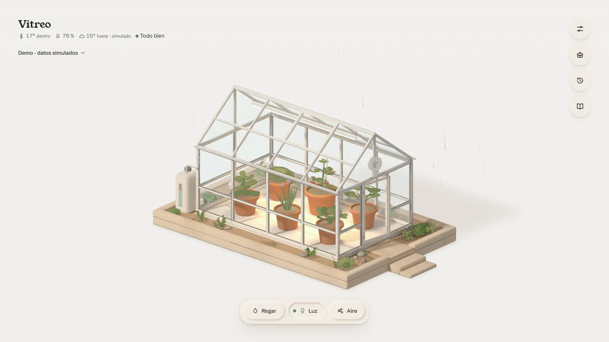

# Vitreo

**Gemelo digital 3D de un invernadero doméstico.** Lo que pasa en el invernadero se ve en la escena, y lo que haces en la escena (regar, encender la luz, ventilar) pasa en el invernadero.

▶ **[Probar la demo](https://vitreo-demo.vercel.app)** (en el navegador, con datos simulados; se puede ver un día en un minuto) · 📖 **[Cómo se hizo](https://vitreo-demo.vercel.app/cuaderno)**

[](https://vitreo-demo.vercel.app)

> **Estado:** funciona completo con un simulador. El hardware (ESP32 y sensores) llega en la siguiente fase.

## Qué hace

- **Estado en vivo** de temperatura, humedad, luz, tierra de cada maceta y depósito, leído primero en la escena: la tierra se aclara al secarse y la planta se mustia.
- **Control y automatizaciones:** riego por umbral, horario de luz, ventilación por temperatura y reglas con el tiempo de fuera (AEMET): ventana cerrada con lluvia o viento y aviso de helada.
- **Datos honestos:** un sensor roto da `null`, nunca un valor inventado, y si se pierde la conexión la escena se "adormece".
- **Seguridad en el dispositivo, no en la app:** tiempo máximo de bomba, nada de riego con el depósito vacío, corte por calor y por helada, y estado seguro si se pierde la conexión. Hoy los aplica el dispositivo simulado; con el hardware, el firmware del ESP32.

## Arquitectura

ESP32 → MQTT (Mosquitto) → hub (Fastify + SQLite) → PWA (React Three Fiber)

- **Contrato MQTT versionado** con esquemas zod: tolerante al leer y estricto al publicar.
- **Hub:** guarda el historial, lo resume por horas y aplica reglas.
- **Simulador:** permite desarrollar sin hardware.
- **Tests e2e:** cuatro entornos aislados en paralelo.

Más detalle en [docs/05](docs/05-arquitectura.md). Toda la documentación (en español) está en [`docs/`](docs/), con el registro de decisiones en [docs/11](docs/11-decisiones.md).

## Probarlo en local

```sh
pnpm install
pnpm demo:dev   # demo sin broker ni hub → http://localhost:5190
```

## In English

Vitreo is a 3D digital twin of a small home greenhouse: a real-time telemetry pipeline (ESP32 → MQTT → Fastify/SQLite hub) with a versioned data contract, and a calm, illustrated 3D PWA built with React Three Fiber. It currently runs on a simulator; the hardware is next. Docs are in Spanish.

---

Este repositorio es una copia pública de `main`, sin su historial; el historial completo se mantiene privado. Código publicado para consulta. Todos los derechos reservados.
